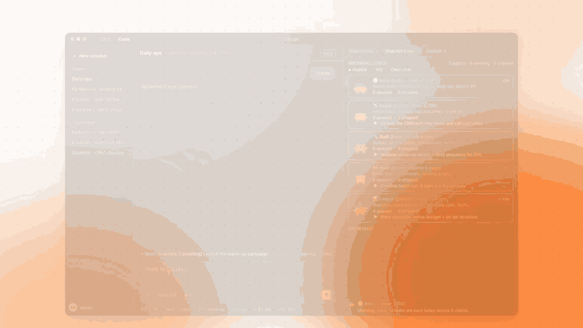
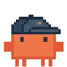
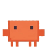
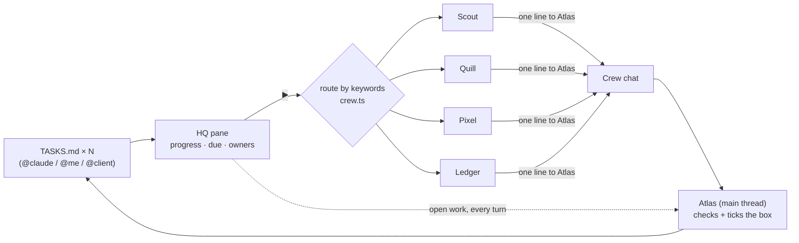

# Crew HQ

**A team of five AI agents that lives inside Claude Code and works through your to-do list with you.**

Hit ▶ on a task and it becomes a prompt, spins up its own Claude Code subagent, and reports back when it's done. The agents huddle in their own group chat and hand work to each other. Your task pane ticks the box by itself.



<sub>16 seconds, recorded on my own setup, where the HQ is named after my agency ([MP4](docs/demo.mp4)). Some numbers in the video were staged for the cut. Everything else is the real mod.</sub>


> Unofficial community mod for Claude Code. Not affiliated with or endorsed by Anthropic.

---

## Meet the crew

| | Agent | Lane | Picks up tasks about |
|---|---|---|---|
|  | **Atlas** | chief of staff (the main thread) | anything nobody else claims; checks every report and ticks the box |
|  | **Scout** | leads & research | leads, CRM, replies, outreach, call outcomes, audiences |
|  | **Quill** | scripts & copy | scripts, emails, SMS sequences, posts, frameworks, slides |
|  | **Pixel** | creative & pages | edits, statics, carousels, landing pages, video, thumbnails |
|  | **Ledger** | numbers & ops | analytics, tracking sheets, budgets, CPL/ROAS, kill/scale calls, SOPs |

Scout, Quill, Pixel and Ledger are real Claude Code subagent types (`crew-hq:scout` and so on), each with its own system prompt. Atlas is your main session.

## What you get

- **An HQ pane** that reads a `TASKS.md` from every project you track. It shows a progress bar per project, what's overdue, what's due today, and who owns each task: you, Claude, or someone you're waiting on.
- **A ▶ button on every `@claude` task.** It routes the task to the right agent, writes the dispatch prompt, and runs it as a subagent.
- **The Crew pane:** live cards for each agent showing their status (working, talking, idle), what they're touching right now, their queue and how much they've shipped.
- **◆ Huddle:** a 7-line standup written by Haiku from your *real* queue. The agents claim work and hand off (Quill writes the script, Pixel cuts it).
- **Report-backs:** each agent ends with one line to Atlas, posted to the crew chat. Atlas checks the work and ticks the box in your `TASKS.md`.
- **Claude always knows what's open.** Your open work is added to every turn's context, so "what's next?" just works. A *Next* band sits above the prompt.

## Install

In a Claude Code terminal session:

```
/plugin install crew-hq --marketplace aayanrehman/crew-hq
```

Answer `y` to add the marketplace and pick the user scope. Then let the bundled **setup skill** wire it to your work:

```
/crew-hq:setup
```

The skill finds your existing `TASKS.md` files (or creates them), writes `~/.claude/crew-hq.json`, and walks you through your first ▶. You don't need to write any code.

### Optional companions (same marketplace)

| Mod | What it does | Install |
|---|---|---|
| **cockpit** | Live gauges for session cost, context and rate limits, a tool-activity sparkline, and what Claude is doing right now. Toasts at $1 / $5 / $10 / $20. | `/plugin install cockpit --marketplace aayanrehman/crew-hq` |
| **done-ping** | A chime plus a summary toast ("Done in 2m 14s · 18 tool calls · 4 files changed") when a task over 45 s finishes. `/ping` to test. | `/plugin install done-ping --marketplace aayanrehman/crew-hq` |
| **seatbelt** | Blocks recursive deletes outside temp/build folders, force pushes, hard resets, `git clean -f`, table drops/truncates, and `.env` edits, before they run. | `/plugin install seatbelt --marketplace aayanrehman/crew-hq` |

Seatbelt is not hypothetical. While I was writing this README it blocked one of my own commands, because the text I was saving mentioned a table drop.

## Your tasks, in plain Markdown

```markdown
## This week
- [ ] Draft the onboarding email sequence @claude (due Oct 14)
- [ ] Landing page for the webinar @claude
- [ ] Call the printer about the proof @me (due Oct 13)
- [ ] Logo files @client
- [x] Kickoff call @me
```

`~/.claude/crew-hq.json` says whose crew it is and which files to read (paths are relative to `$HOME`):

```json
{
  "owner": "Sam",
  "team": "Sam's design studio",
  "projects": [
    { "name": "Client A", "file": "Projects/client-a/TASKS.md" },
    { "name": "Newsletter", "file": "Documents/newsletter/TASKS.md" }
  ]
}
```

The files stay ordinary Markdown: readable without the mod, diffable, and editable by you or by Claude. Ticking a box in the pane edits the file, and when Claude edits the file the pane updates.

## How it works



About 900 lines of TypeScript, using the mod hooks Claude Code exposes:

| Hook | Used for |
|---|---|
| `session.start` | registers `/hq` and `/crew`, the four subagent types, and a 60 s refresh |
| `ui.render` (Pane, AbovePrompt) | the HQ pane, the Crew pane with pixel-sprite mascots, and the *Next* band |
| `agent.spawn`, `tool.call`, `turn.complete` | lights each agent's card while it runs, shows what it's touching, and posts its report |
| `prompt.compose` | appends your open work and the crew roster to the session context |
| `model.complete` (Haiku) | the huddle, parsed line by line into chat messages |
| `tool.call` on Edit/Write of `TASKS.md` | refreshes the panes the moment Claude ticks a box |

## Make it yours

The roster lives in [`mods/crew-hq/hooks/crew.ts`](mods/crew-hq/hooks/crew.ts). Every agent is one object with a name, a role, a bio, a colour and a routing regex. Rename them, change their lanes or add a sixth, then install your fork with `/plugin install crew-hq --marketplace <you>/crew-hq`.

## Develop

```bash
claude plugin validate .                 # marketplace + every mod
claude plugin test mods/crew-hq          # 10 tests: routing, huddle parsing, panes, agent lifecycle
claude plugin test mods/seatbelt         # 3 tests: what gets blocked, what doesn't
claude --plugin-dir mods/crew-hq         # run a session with your local copy
```

## Build your own

I wrote up exactly how I built the crew, with every prompt and reference doc I used, so you can build your own version without writing code. I share it with people from my [LinkedIn post](https://www.linkedin.com/in/aayanurrehman/). Comment there or send me a message and I'll send it over.

---

Built by [Aayan Ur Rehman](https://aayanrehman.com) · [LinkedIn](https://www.linkedin.com/in/aayanurrehman/) · MIT licensed
